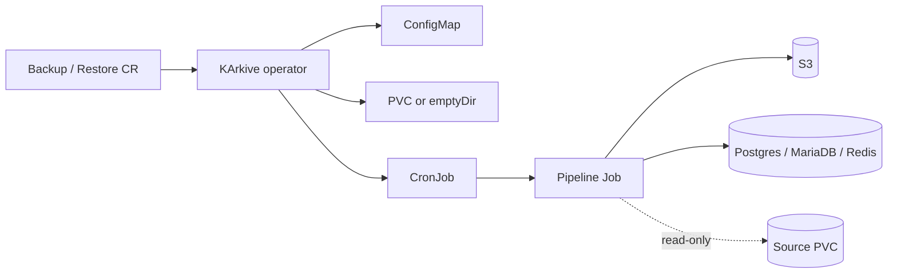

# KArkive

[](https://karkive.ir)
[](https://github.com/mahdidarabi/karkive/actions/workflows/ci.yaml)
[](https://github.com/mahdidarabi/karkive/pkgs/container/charts%2Fkarkive)
[](https://github.com/mahdidarabi/karkive/pkgs/container/karkive)
[](https://go.dev/)
[](https://github.com/mahdidarabi/karkive/tree/main/api/v1alpha1)

Site: **[karkive.ir](https://karkive.ir)**

Kubernetes operator for **scheduled logical backups and restores**. You declare a `Backup` or `Restore` CR; KArkive owns a ConfigMap, an optional PVC and a CronJob whose pod dumps, compresses (zstd), encrypts (gpg or age) and streams to S3 with rclone, or runs the same pipe in reverse to restore.

**Engines:** PostgreSQL · MariaDB · Redis · PVC files (`tar`, backup only)

The operator never creates Secrets. It only reads `spec.secretRef` (and the engine Secret of a Restore) from the CR's namespace.

```text
kubectl get backups,restores
# short names: kbackup / bak, krestore / res
```

---

## Contents

- [How it works](#how-it-works)
- [Install](#install)
- [Backup](#backup)
  - [PVC backup](#pvc-backup)
- [Restore](#restore)
- [Secrets](#secrets)
  - [Encryption: gpg or age](#encryption-gpg-or-age)
- [Status](#status)
- [Monitoring](#monitoring)
- [Webhooks](#webhooks)
- [Configuration](#configuration)
- [Development](#development)
- [Layout](#layout)

## How it works

A CR named `app-postgres` is reconciled into owned resources prefixed by kind, so a Backup and a Restore can share a name:

| Resource | Backup | Restore | Notes |
| --- | --- | --- | --- |
| ConfigMap | `karkive-backup-app-postgres` | `karkive-restore-app-postgres` | Pipeline settings and embedded scripts |
| PVC | `karkive-backup-app-postgres` | `karkive-restore-app-postgres` | Scratch volume; `spec.persistence.enabled: false` uses an emptyDir |
| CronJob | `karkive-backup-app-postgres` | `karkive-restore-app-postgres` | One Job per schedule, or `kubectl create job --from=cronjob/…` |
| Deployment | `karkive-backup-app-postgres-holder` | `karkive-restore-app-postgres-holder` | Only with `spec.runtime.mode: CronJobWithVolumeHolder` |



### Stream pipeline (default)

Each Job runs one container from the engine's runner image, and no plain dump touches the disk:

- **Backup:** clean up local scratch, then `dump | compress | encrypt | rclone rcat` straight into S3, then prune S3 objects past `spec.s3.retentionDays` (best effort: a failed delete is logged and retried on the next run, never failing a backup that is already uploaded).
- **Restore:** pick the object, then `rclone cat | decrypt`, then load.

| Engine | Backup | Restore | Object |
| --- | --- | --- | --- |
| `postgres` | `pg_dump --format=custom --compress=zstd:N`; with `jobs > 1`, `--format=directory --jobs` to scratch, then tar | `pg_restore --jobs`, then `vacuumdb --analyze-only`; TimescaleDB loads at the source's extension version (from the `.meta` sidecar), then `ALTER EXTENSION UPDATE` | `pg_dump-<db>-<ts>.dump.gpg` / `.dir.tar.gpg` |
| `mariadb` | `mariadb-dump --single-transaction --quick \| zstd -T0` | streamed into `mariadb` (any target database name) | `mysqldump-<db>-<ts>.sql.zst.gpg` |
| `redis` | `redis-cli --rdb - \| zstd -T0` | RDB into an in-pod `redis-server`; the target `REPLICAOF`s it | `redisdump-<name>-<ts>.rdb.zst.gpg` |
| `pvc` | `tar \| zstd -T0` | not implemented ([restore manually](#pvc-backup)) | `pvcdump-<claim>-<ts>.tar.zst.gpg` |

`<ts>` is UTC `yyyy-mm-dd-HH-MM-SS`. With `spec.encryption.method: age` every object ends in `.age` instead of `.gpg`. On a 300 MB pgbench database the Stream dump was 1.6 MiB against 8.4 MiB for plain SQL + gzip, and the restore took 4 s with `--jobs=4`.

```yaml
spec:
  pipeline:
    mode: Stream         # default; Stage is opt-in
    jobs: 4              # pg_dump/pg_restore/vacuumdb --jobs (default 1 backup, 2 restore)
    compressionLevel: 3  # zstd 1-19
```

Runner images are `ghcr.io/mahdidarabi/karkive-runner-<engine>` (built from `runner/<engine>/`) and ship the client tools, `zstd`, `gpg`, `age` and `rclone`. Override one per CR with `spec.images.runner`, or operator-wide with `defaults.runnerImages.<engine>`.

### Stage pipeline (`spec.pipeline.mode: Stage`)

The opt-in alternative: one container per stage, handing off through marker files on the shared volume, with gzip instead of zstd. It is planned for removal before 1.0.0.

- **Backup:** `cleanup` → dump → `compress` → `encrypt` → `s3-sync` (no `s3-sync` when `spec.s3.enabled` is false)
- **Restore:** `cleanup` → `fetch` → `decrypt` → `extract` → restore

| Engine | Dump | Restore | Object |
| --- | --- | --- | --- |
| `postgres` | plain-SQL `pg_dump` | `psql` | `pg_dump-<db>-<ts>.pgdump.gz.gpg` |
| `mariadb` | `mysqldump --databases` | `mariadb` | `mysqldump-<db>-<ts>.sql.gz.gpg` |
| `redis` | `redis-cli --rdb` | ephemeral `redis-server` + `REPLICAOF` | `redisdump-<name>-<ts>.rdb.gz.gpg` |
| `pvc` | GNU `tar` | not implemented | `pvcdump-<claim>-<ts>.tar.gz.gpg` |

Here `<ts>` is `yyyy-mm-dd-HH-MM`. Stages run upstream images: BusyBox, `vladgh/gpg` (or `defaults.ageImage` with age), `rclone/rclone`, CloudNativePG PostgreSQL 18.4, MariaDB 10.6, Redis 7.4 and Debian trixie-slim (GNU tar).

A Stream Restore reads Stage objects too (`*.gz.gpg` / `*.gz.age`); a Stage Restore reads only Stage objects. A Restore that stays on Stage needs its Backup on Stage too.

### Runtime

`spec.runtime.mode` (default `CronJob`) selects how pipeline pods relate to the PVC:

| Mode | Status |
| --- | --- |
| `CronJob` | New Job pod each run (CSI attach/detach every time). |
| `CronJobWithVolumeHolder` | A pause Deployment keeps the PVC attached on one node; Job pods colocate with required podAffinity on `kubernetes.io/hostname`. Requires `spec.persistence.enabled`. Ready waits until the holder is Available. |
| `PersistentPodWithTriggerJob` | Reserved; admission rejects it. |
| `PersistentPodWithInPodCron` | Reserved; admission rejects it. |

Use `CronJobWithVolumeHolder` where a new Job cannot attach the claim after the previous pod is gone. RWO still allows several pods on **one node**: the holder is the long-lived attacher, the Job only mounts.

```yaml
spec:
  runtime:
    mode: CronJobWithVolumeHolder
  persistence:
    enabled: true
```

## Install

Current release: **`0.4.0`**

```bash
helm install karkive oci://ghcr.io/mahdidarabi/charts/karkive \
  --version 0.4.0 \
  -n karkive-system --create-namespace
```

With Prometheus Operator scrape, alerts and a Grafana dashboard ConfigMap:

```bash
helm upgrade --install karkive oci://ghcr.io/mahdidarabi/charts/karkive \
  --version 0.4.0 \
  -n karkive-system --create-namespace \
  --set metrics.serviceMonitor.enabled=true \
  --set metrics.prometheusRule.enabled=true \
  --set metrics.grafanaDashboard.enabled=true
```

On GitOps (Argo CD, Flux), let cert-manager issue the webhook serving cert so Helm does not generate a new CA on every render. cert-manager must already be installed; if the Helm-generated Secret exists, delete it once so cert-manager can create it.

```bash
helm upgrade --install karkive oci://ghcr.io/mahdidarabi/charts/karkive \
  --version 0.4.0 \
  -n karkive-system --create-namespace \
  --set webhook.certManager.enabled=true
```

The chart applies the Backup and Restore CRDs (`crds.install`, default true), so `helm upgrade` updates the schema. Uninstall keeps the CRDs.

## Backup

```yaml
apiVersion: karkive.io/v1alpha1
kind: Backup
metadata:
  name: app-postgres
  namespace: backup
spec:
  engine: postgres          # postgres | mariadb | redis | pvc
  schedule: "0 2 * * *"
  database:
    host: postgres.example.svc.cluster.local
    port: 5432              # defaults: 5432 / 3306 / 6379
    name: app
  s3:
    enabled: true           # false → no upload; dumps stay in retained/ on the PVC
    endpoint: https://s3.example.com
    bucket: backups
    path: app/pgdump
    retentionDays: 14
  secretRef:
    name: backup-app-postgres
  persistence:
    enabled: true           # false → emptyDir
    size: 1Gi
    storageClassName: standard
  localRetentionDays: 7     # retained/ dumps on the PVC
  # encryption:
  #   method: age           # gpg (default) | age; age needs age_recipient in the Secret
```

MariaDB, Redis and PVC samples live under [`examples/`](examples/).

| Field | Default | Purpose |
| --- | --- | --- |
| `spec.s3.enabled` | `true` | Upload to S3. `false` keeps encrypted dumps in `retained/` on the PVC (requires persistence; no S3 keys, endpoint or bucket) |
| `spec.s3.retentionDays` | `14` | Age after which S3 objects (and `.meta` sidecars) are pruned |
| `spec.localRetentionDays` | `7` | Age after which `retained/` dumps and log files are pruned |
| `spec.persistence.size` | `1Gi` | Scratch PVC (or emptyDir limit). Raising it expands the PVC (StorageClass needs `allowVolumeExpansion: true`); lowering it is ignored |
| `spec.pipeline` | `mode: Stream` | `Stream` or `Stage`; `jobs`, `compressionLevel` (Stream only) |
| `spec.encryption.method` | `gpg` | `gpg` (`gpg_passphrase`) or `age` (`age_recipient`); see [Encryption](#encryption-gpg-or-age) |
| `spec.runtime.mode` | `CronJob` | See [Runtime](#runtime) |
| `spec.suspend` | `false` | Stop the schedule; the CronJob stays for manual Jobs |
| `spec.logFileEnabled` | `false` | Also write logs to `logs/<pod>.log` on the volume |
| `spec.job.concurrencyPolicy` | `Forbid` | CronJob concurrency |
| `spec.job.restartPolicy` | `Never` | `OnFailure` restarts a container in place, which breaks Stage hand-offs |
| `spec.job.backoffLimit` | `3` | Job retries (new pod each time) |
| `spec.job.ttlSecondsAfterFinished` | `86400` | Cleanup of finished Jobs |
| `spec.job.timeZone` | — | CronJob time zone |
| `spec.images` | operator defaults | `runner` (Stream); `busybox`, `gnupg`, `age`, `postgres`, `mariadb`, `redis`, `tar`, `rclone` (Stage) |
| `spec.resources` | — | `stream` (Stream); `cleanup`, `dump`, `compress`, `encrypt`, `s3Sync` (Stage) |
| `spec.component` | CR name | `app.kubernetes.io/component` label |

Trigger a run without waiting for the schedule:

```bash
kubectl create job --from=cronjob/karkive-backup-app-postgres app-postgres-manual -n backup
```

### PVC backup

`engine: pvc` archives the files of an existing PersistentVolumeClaim instead of dumping a database. `spec.database` is not used, and the Secret needs no `username` / `password`.

```yaml
apiVersion: karkive.io/v1alpha1
kind: Backup
metadata:
  name: nextcloud-data
  namespace: nextcloud      # must be the claim's namespace
spec:
  engine: pvc
  schedule: "0 3 * * *"
  pvc:
    claimName: nextcloud-data
    path: data              # optional subdirectory; default the whole claim
    excludes: ["*.part", "./appdata_*/preview"]
    consumerSelector:       # RWO claim in use: schedule on the app's node
      matchLabels:
        app.kubernetes.io/name: nextcloud
  s3:
    path: nextcloud/pvcdump
  secretRef:
    name: backup-nextcloud-data   # gpg_passphrase or age_recipient, plus S3 keys
```

| Field | Default | Purpose |
| --- | --- | --- |
| `spec.pvc.claimName` | required | Source claim in the Backup's namespace, mounted **read-only**. `ReadWriteOncePod` claims are rejected |
| `spec.pvc.path` | claim root | Relative subdirectory to archive (no leading `/`, no `..`) |
| `spec.pvc.excludes` | — | GNU tar `--exclude` patterns. `cache` matches at any depth; `./cache` only at the top |
| `spec.pvc.consumerSelector` | — | Labels of the pods that mount the claim. Adds required podAffinity (`kubernetes.io/hostname`) to Job pods and the volume holder |
| `spec.pvc.runAsUser` / `runAsGroup` | root | Unset: root with only `CAP_DAC_OVERRIDE` (reads any file). Set a non-root UID where Pod Security `restricted` applies; tar then reads only what that UID can |

Things to know:

- **Namespace.** Pods can only mount claims in their own namespace, so the Backup and its Secret live next to the claim, not in a central `backup` namespace.
- **RWO claims.** A `ReadWriteOnce` claim attaches to one node. If the app is running, set `consumerSelector`, or the Job pod may land elsewhere and hang on `Multi-Attach`. While it is set, Jobs stay `Pending` when no matching pod runs. RWX claims need no selector.
- **Consistency.** tar reads a live filesystem. Files that change mid-read are kept with a warning; the archive is not point-in-time. Quiesce the app, or back up databases with their own engine.
- **Scratch size.** Stream streams the archive to S3 and needs no scratch, so `persistence.enabled: false` is fine when S3 is on. With S3 off, size the PVC for `retained/` copies over `localRetentionDays`. Stage mode also writes the uncompressed `.tar` and the `.tar.gz` there.
- **Pod Security.** By default tar runs as root with `CAP_DAC_OVERRIDE` (allowed by `baseline`, not `restricted`). The source is mounted read-only and never chowned (`readOnly` also skips `fsGroup`).
- **Restore** is not automated (a `Restore` rejects `engine: pvc`). Download the object, then with the app stopped:

```bash
# gpg
gpg --batch --pinentry-mode loopback --passphrase-file gpg_passphrase --decrypt pvcdump-nextcloud-data-<ts>.tar.zst.gpg \
  | zstd -d | tar -x --numeric-owner -C /path/to/mounted/claim
# age
age --decrypt -i age.key pvcdump-nextcloud-data-<ts>.tar.zst.age | zstd -d | tar -x --numeric-owner -C /path/to/mounted/claim
# Stage objects (*.tar.gz.gpg / *.tar.gz.age): replace `zstd -d | tar -x` with `tar -xz`
```

## Restore

A Restore's `secretRef` holds only S3 keys and the decryption key. Target credentials come from `spec.postgresSecret`, `spec.mariadbSecret` or `spec.redisSecret`.

```yaml
apiVersion: karkive.io/v1alpha1
kind: Restore
metadata:
  name: app-postgres
  namespace: backup
spec:
  engine: postgres          # postgres | mariadb | redis
  schedule: "30 2 * * *"
  suspend: true             # typical: run on demand
  database:
    host: postgres-sandbox.example.svc.cluster.local
    port: 5432
    name: app
    ownerRole: app
  s3:
    endpoint: https://s3.example.com
    bucket: backups
    path: app/pgdump
  secretRef:
    name: restore-app-postgres
  postgresSecret:
    name: postgres
  persistence:
    enabled: false
    size: 2Gi
  useLatestBackupAsFallback: true
  dropDatabaseIfExists: true
  # encryption:
  #   method: age           # must match the Backup; needs age_identity in the Secret
```

| Field | Default | Purpose |
| --- | --- | --- |
| `spec.backupFile` | empty | Specific S3 object name |
| `spec.useLatestBackupAsFallback` | `true` | Newest object (by S3 upload time) matching the engine and encryption method when `backupFile` is empty or missing |
| `spec.encryption.method` | `gpg` | Must match the Backup: `gpg` (`gpg_passphrase`) or `age` (`age_identity`) |
| `spec.dropDatabaseIfExists` | `true` | Replace a non-empty target. When false, a non-empty target fails the Job |
| `spec.stripPgAuditExtension` | `true` | Skip pgAudit extension, event-trigger and function DDL (Postgres) |
| `spec.database.ownerRole` | `database.name` | Postgres owner of the recreated database |
| `spec.persistence` | PVC, `1Gi` | Scratch. Postgres custom/directory dumps land here once, because `pg_restore --jobs` needs a seekable file; Redis writes the RDB here |
| `spec.pipeline.jobs` | `2` | `pg_restore` / `vacuumdb --jobs` (Stream) |
| `spec.job.backoffLimit` | `1` | Fail fast |
| `spec.runtime.mode` | `CronJob` | Same modes as Backup |

`spec.s3.enabled: false` is rejected: restoring from local `retained/` dumps is not implemented.

Per engine:

- **Postgres.** The target database is recreated from `template0` with `ownerRole` as owner. Roles the dump references are created `NOLOGIN` when missing. Database and owner names must match `[A-Za-z0-9_-]+`.
- **MariaDB.** The database is recreated with utf8mb4, any target name works, and `DEFINER`s become `CURRENT_USER`; GTID and `SQL_LOG_BIN` lines are dropped.
- **Redis.** The RDB loads into a `redis-server` in the Job pod on `:6380`; the target runs `REPLICAOF` against it, then `REPLICAOF NO ONE`. The target must be able to connect to the Job pod and allow `REPLICAOF` and `CONFIG SET`. A non-empty target is replaced only with `dropDatabaseIfExists`.

## Secrets

The operator does not create or mutate Secrets. Apply them yourself in the CR's namespace. A missing Secret leaves the CR `Pending` (rechecked every 30s); a missing key sets it to `Error`.

**Backup** (`spec.secretRef`):

| Key | Used for |
| --- | --- |
| `username` | DB user (Redis ACL user; `default` means no ACL user). Not used for engine `pvc` |
| `password` | DB password. Not used for engine `pvc` |
| `s3_access_key`, `s3_secret_key` | S3 (omit when `spec.s3.enabled` is false) |
| `gpg_passphrase` | Symmetric encryption (`spec.encryption.method: gpg`, the default) |
| `age_recipient` | Instead of `gpg_passphrase` with `method: age`: one or more `age1...` public keys, one per line |

**Restore**:

| Source | Keys |
| --- | --- |
| `spec.secretRef` | `s3_access_key`, `s3_secret_key`, and `gpg_passphrase` (gpg) or `age_identity` (age private key `AGE-SECRET-KEY-1...`) |
| `spec.postgresSecret` / `mariadbSecret` / `redisSecret` | `username` / `password` by default (`usernameKey` / `passwordKey` override; the Redis username is optional) |

```yaml
apiVersion: v1
kind: Secret
metadata:
  name: backup-app-postgres
  namespace: backup
type: Opaque
stringData:
  username: app
  password: change-me
  s3_access_key: change-me
  s3_secret_key: change-me
  gpg_passphrase: change-me
```

See [`config/samples/backup-secret.yaml`](config/samples/backup-secret.yaml).

### Encryption: gpg or age

`spec.encryption.method` is the same field on Backup and Restore, and a Restore must use the method of the Backup it reads.

| Method | Backup Secret key | Restore Secret key | Object suffix |
| --- | --- | --- | --- |
| `gpg` (default) | `gpg_passphrase` | `gpg_passphrase` | `.gpg` |
| `age` | `age_recipient` (public key) | `age_identity` (private key) | `.age` |

With `age` (X25519), a Backup holds only the public key, so a leaked Backup Secret cannot decrypt anything; only Restores hold the private key. `age` is also faster than gpg on large streams.

```bash
age-keygen -o age.key                      # prints "Public key: age1..."
kubectl -n backup create secret generic backup-app-postgres \
  --from-literal=age_recipient="$(age-keygen -y age.key)" \
  --from-literal=username=app --from-literal=password=change-me \
  --from-literal=s3_access_key=change-me --from-literal=s3_secret_key=change-me
kubectl -n backup create secret generic restore-app-postgres \
  --from-file=age_identity=age.key \
  --from-literal=s3_access_key=change-me --from-literal=s3_secret_key=change-me
```

```yaml
spec:
  encryption:
    method: age
```

- **Restore selection.** "Latest" only considers objects of the Restore's method; a `backupFile` of the other method fails before download.
- **Sidecar.** The Postgres `.meta` sidecar drops the suffix (`pg_dump-app-<ts>.dump.meta`) for both methods.
- **Retention.** S3 prune and `retained/` cleanup delete expired `.gpg` and `.age` objects alike, so switching a Backup's method still ages out the old objects. Until then, a Restore with `method: gpg` still reads them.
- **Stage mode** runs encrypt and decrypt in `defaults.ageImage` (default: the pvc runner image) instead of `vladgh/gpg`, which has no `age`. Any image with `/bin/sh` and `age` works; override per CR with `spec.images.age`.
- **Manual decrypt:** `age --decrypt -i age.key <object>.age > <object>`.

See [`examples/backup-postgres-age.yaml`](examples/backup-postgres-age.yaml) and [`examples/restore-postgres-age.yaml`](examples/restore-postgres-age.yaml).

## Status

`status.phase` and the **Ready** condition only report the owned resources: `Pending` (waiting for a Secret, source PVC or volume holder), `Ready` (synced), `Error` (invalid spec, missing Secret key, apply failure) or `Unsupported` (engine). A CR stays `Ready` while the last dump failed.

The last finished Job is the **BackupSucceeded** / **RestoreSucceeded** condition (`True` / `False` / `Unknown` until a Job finishes) plus `status.lastJob`:

```yaml
status:
  phase: Ready
  cronJobName: karkive-backup-app-postgres
  lastScheduleTime: "2026-11-20T02:00:00Z"
  lastSuccessfulTime: "2026-11-20T02:04:12Z"
  lastJob:
    name: karkive-backup-app-postgres-29781240
    outcome: Succeeded   # or Failed, with reason and message
  conditions:
    - type: Ready
      status: "True"
      reason: Synced
    - type: BackupSucceeded
      status: "True"
      reason: JobSucceeded
```

```bash
kubectl get bak,res -A
kubectl describe backup app-postgres -n backup
```

Print columns: engine, schedule, phase, Succeeded, last success (Backup only) and last Job outcome.

## Monitoring

The chart exposes `/metrics` on a ClusterIP Service (`:8080`) and `/healthz` + `/readyz` on `:8081`.

Custom series exist for both kinds (`karkive_backup_*` and `karkive_restore_*`), labeled `namespace`, `name`, `engine`:

| Metric | Meaning |
| --- | --- |
| `…_ready` | `1` when phase is `Ready` (resources synced, not the last Job outcome) |
| `…_suspended` | `spec.suspend` |
| `…_last_schedule_timestamp_seconds` | Last CronJob schedule |
| `…_last_successful_timestamp_seconds` | Last successful Job |
| `…_last_job_failed` | `1` when the last finished Job failed |
| `…_last_job_duration_seconds` | Wall time of the last finished Job |
| `…_last_job_info` | Always `1`; labels `outcome`, `reason`, `job_name` |

Alerts (with `metrics.prometheusRule.enabled=true`):

- CR not Ready for 15m
- Last Job failed
- Backup's last success older than `backupAgingSeconds` (default 8h), and stale past `backupStaleSeconds` (default 36h); suspended Backups are skipped
- CronJob has scheduled but no Job has finished
- Missed CronJob schedule (needs kube-state-metrics)

When one Prometheus holds several KArkive installs (for example clusters sending remote_write with an external label), set `metrics.grafanaDashboard.sourceLabel` to the label that tells them apart (`cluster`, `k8s_cluster`, `region`; empty by default). The dashboard then gets a variable titled after the label and keeps it in every aggregation, so a Backup with the same name in two sources shows as two rows. Series without the label still show. `metrics.grafanaDashboard.folder` sets the Grafana sidecar folder.

## Webhooks

Validating admission webhooks reject invalid `Backup` / `Restore` specs: cron schedule, required fields per engine, `spec.pvc` rules, S3 and persistence combinations, runtime and pipeline modes, `jobs` (1–32) and `compressionLevel` (1–19), the encryption method and Job policies. The controller runs the same checks and sets `Error` / `InvalidSpec` when webhooks are off.

Webhooks are **on** in the Helm chart and **off** for `make run`. Serving certs default to Helm `genCA`, which changes on every render; on GitOps set `webhook.certManager.enabled=true` ([Install](#install)).

## Configuration

Operator-wide defaults (Helm `values.yaml` → flags):

| Helm | Flag | Default |
| --- | --- | --- |
| `watchNamespace` | `WATCH_NAMESPACE` | all namespaces |
| `leaderElection` | `--leader-elect` | `true` in the chart |
| `defaults.runnerImages.<engine>` | `--runner-<engine>-image` | `ghcr.io/mahdidarabi/karkive-runner-<engine>:<runner/<engine>/TAG>`, e.g. `pg18.7-rclone1.76.0-r2` (Stream) |
| `defaults.s3.endpoint` | `--default-s3-endpoint` | empty (then required on the CR when S3 is on) |
| `defaults.s3.bucket` | `--default-s3-bucket` | empty (then required on the CR when S3 is on) |
| `defaults.busyboxImage` | `--busybox-image` | `busybox:1.37` (Stage) |
| `defaults.gnupgImage` | `--gnupg-image` | `vladgh/gpg:1.3.11` (Stage) |
| `defaults.ageImage` | `--age-image` | the pvc runner image (Stage, `method: age`; needs `/bin/sh` and `age`) |
| `defaults.rcloneImage` | `--rclone-image` | `rclone/rclone:1.76.0` (Stage) |
| `defaults.postgresImage` | `--postgres-image` | `cloudnative-pg/postgresql:18.4` (Stage) |
| `defaults.mariadbImage` | `--mariadb-image` | `mariadb:10.6` (Stage) |
| `defaults.redisImage` | `--redis-image` | `redis:7.4` (Stage) |
| `defaults.tarImage` | `--tar-image` | `debian:trixie-slim` (Stage, engine `pvc`) |

Per-CR `spec.s3.endpoint` / `spec.s3.bucket` override the operator defaults. `spec.s3.path` is always required when S3 is on.

## Development

Requires Go (see `go.mod`) and a kubeconfig.

```bash
make generate manifests test
make run                    # against the current cluster; webhooks off

kubectl apply -f config/crd/bases
kubectl apply -f config/samples/backup-secret.yaml
kubectl apply -f config/samples/karkive_v1alpha1_backup.yaml
```

| Target | What it does |
| --- | --- |
| `make generate` | Deepcopy for `api/` |
| `make manifests` | CRDs, RBAC and webhook manifests, plus the chart's CRD templates |
| `make test` | `go test ./...` |
| `make fmt vet` | `go fmt` / `go vet` |
| `make docker-build` | Operator image (`IMG`, default `ghcr.io/mahdidarabi/karkive:dev`) |
| `make install` / `uninstall` | Apply / delete CRDs |

CI:

- **CI** (`ci.yaml`, pushes to `main`, tags `v*` and PRs; `docs/` changes skip it): `make generate manifests fmt vet test`, failing on a dirty tree, then builds the `linux/amd64` operator image and lints the chart. Pushes to `main` publish `ghcr.io/mahdidarabi/karkive:latest`, `main` and `sha-<sha>`; tags `v*` publish semver tags and push the chart to `oci://ghcr.io/mahdidarabi/charts`.
- **Runners** (`runners.yaml`): builds `karkive-runner-<engine>` only when `runner/<engine>/` (or the shared rclone installer) changes. The tag comes from `runner/<engine>/TAG`, `<client><version>-rclone<version>-r<revision>`. A published tag is never overwritten, so bump a version or the `-r` revision with every Dockerfile change, then update `internal/config/config.go` and `defaults.runnerImages` in `values.yaml`.
- **Pages** (`pages.yaml`): deploys `docs/` to [karkive.ir](https://karkive.ir).

To release: set `version` and `appVersion` in `charts/karkive/Chart.yaml` to the new version (CI fails the tag otherwise), update the version in this README and `docs/index.html`, then push tag `v<version>`.

## Layout

```text
api/v1alpha1/            Backup + Restore types, validation, webhooks (karkive.io)
cmd/                     Operator entrypoint
internal/
  controller/            Reconcile loops + last-Job status
  resources/             ConfigMap / PVC / CronJob / volume-holder builders
  pipeline/scripts/      Embedded shell: stream/ (default), backup/ + restore/ (Stage)
  metrics/               Prometheus collector
  config/                Operator-wide image / S3 defaults
  jobstatus/             Job Complete / Failed parsing
runner/<engine>/         Stream runner images (Dockerfile + TAG)
charts/karkive/          Helm chart (CRDs, RBAC, webhook, metrics, dashboard)
docs/                    Landing page (GitHub Pages → karkive.ir)
config/crd/bases/        Generated CRDs
config/samples/          Sample Backup / Restore / Secret
examples/                Postgres, MariaDB, Redis, PVC and age CRs
hack/                    Codegen helpers
```
