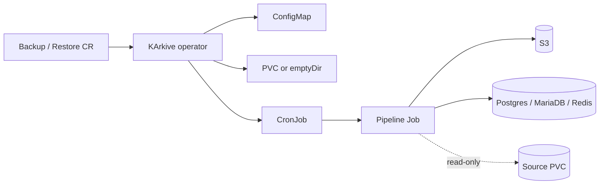

# KArkive

[](https://karkive.ir)
[](https://github.com/mahdidarabi/karkive/actions/workflows/ci.yaml)
[](https://github.com/mahdidarabi/karkive/pkgs/container/charts%2Fkarkive)
[](https://github.com/mahdidarabi/karkive/pkgs/container/karkive)
[](https://go.dev/)
[](https://github.com/mahdidarabi/karkive/tree/main/api/v1alpha1)

Site: **[karkive.ir](https://karkive.ir)**

Kubernetes operator for **scheduled logical backups and restores**. You declare a `Backup` or `Restore` CR; KArkive owns a ConfigMap, optional PVC, and CronJob that dump, gzip, GPG-encrypt, and optionally sync to S3 (and the reverse).

**Engines:** PostgreSQL · MariaDB · Redis · PVC files (`tar`, backup only)

The operator never creates Secrets. It only reads `spec.secretRef` (and the engine-specific restore secret) from the same namespace as the CR.

```text
kubectl get backups,restores
# short names: kbackup / bak, krestore / res
```

---

## Contents

- [How it works](#how-it-works)
- [Install](#install)
  - [Upgrade from 0.0.3](#upgrade-from-003)
- [Backup](#backup)
- [Restore](#restore)
- [Secrets](#secrets)
  - [Encryption: gpg or age](#encryption-gpg-or-age)
- [Status](#status)
- [Monitoring](#monitoring)
- [Webhooks](#webhooks)
- [Configuration](#configuration)
- [Development](#development)
- [Layout](#layout)

## How it works

A CR named `app-postgres` is reconciled into owned resources prefixed by kind:

| Resource | Backup | Restore | Notes |
| --- | --- | --- | --- |
| ConfigMap | `karkive-backup-app-postgres` | `karkive-restore-app-postgres` | Embedded pipeline scripts |
| PVC | `karkive-backup-app-postgres` | `karkive-restore-app-postgres` | Skip with `spec.persistence.enabled: false` (emptyDir) |
| CronJob | `karkive-backup-app-postgres` | `karkive-restore-app-postgres` | One Job per schedule (or `kubectl create job --from=…`) |
| Deployment | `karkive-backup-app-postgres-holder` | `karkive-restore-app-postgres-holder` | Only when `spec.runtime.mode: CronJobWithVolumeHolder` |



### Stream pipeline (default)

One container per Job instead of five, and no plain dump on disk:

- **Backup:** clean up the local scratch, then `dump | compress | gpg | rclone rcat` (or `age -r` with `spec.encryption.method: age`) straight into S3, then prune S3 objects past `retentionDays` (best effort).
- **Restore:** `rclone cat | gpg -d` (or `age -d -i`), then load. Postgres dumps load with `pg_restore --jobs`; MariaDB streams into `mariadb`.

| Engine | Backup | Restore | Object |
| --- | --- | --- | --- |
| `postgres` | `pg_dump --format=custom --compress=zstd:N`; with `jobs > 1`, `--format=directory --jobs` to scratch, then tar | `pg_restore --jobs`, `vacuumdb --analyze-only`; TimescaleDB loads at the source's extension version (from the `.meta` sidecar), then `ALTER EXTENSION UPDATE` | `pg_dump-<db>-<ts>.dump.gpg` / `.dir.tar.gpg` |
| `mariadb` | `mariadb-dump --single-transaction --quick \| zstd -T0` | streamed into `mariadb` (any target database name) | `mysqldump-<db>-<ts>.sql.zst.gpg` |
| `redis` | `redis-cli --rdb - \| zstd -T0` | RDB into an in-pod `redis-server`, target `REPLICAOF` it (target must reach the Job pod on `:6380`) | `redisdump-<name>-<ts>.rdb.zst.gpg` |
| `pvc` | `tar \| zstd -T0` | not implemented | `pvcdump-<claim>-<ts>.tar.zst.gpg` |

```yaml
spec:
  pipeline:
    mode: Stream         # default; Stage is opt-in
    jobs: 4              # pg_dump/pg_restore --jobs (default 1 backup, 2 restore)
    compressionLevel: 3  # zstd 1-19
```

With `spec.encryption.method: age` every object above ends in `.age` instead of `.gpg`. A Stream Restore also reads Stage objects (`*.gz.gpg`, or `*.gz.age` with age), so you can switch a Restore first and the Backup later. On a 300 MB pgbench database the Stream dump was 1.6 MiB against 8.4 MiB for plain SQL + gzip, and the restore took 4 s with `--jobs=4`.

Since this release a Backup or Restore without `spec.pipeline.mode` runs Stream; set `mode: Stage` to keep the old per-stage containers. A Stage Restore cannot read Stream objects, so a Restore that must stay on Stage needs its Backup on Stage too.

Each engine has its own runner image, `ghcr.io/mahdidarabi/karkive-runner-<engine>` (`runner/<engine>/`). It holds the client tools, `zstd`, `gpg`, `age` and `rclone`. The `Runners` workflow builds an image only when its folder changes. Tags name the tool versions inside, `<client><version>-rclone<version>-r<revision>` (for example `karkive-runner-postgres:pg18.7-rclone1.76.0-r2`), and come from `runner/<engine>/TAG`. Bump the versions or the `-r` revision with every Dockerfile change: CI never overwrites a published tag. Override it per CR with `spec.images.runner`, or operator-wide with `defaults.runnerImages`.

### Stage pipeline (`spec.pipeline.mode: Stage`)

One container per stage, handing off through marker files on the shared volume.

**Backup:** `cleanup` → dump → `compress` → `encrypt` → `s3-sync` (omit `s3-sync` when `spec.s3.enabled` is false)

After the upload, `s3-sync` deletes objects older than `spec.s3.retentionDays`. This prune is best effort: a failed delete is retried, then logged as `WARN` and left for the next run, so it never fails a backup that is already uploaded.

**Restore:** `cleanup` → `fetch` → `decrypt` → `extract` → restore

| Engine | Dump | Restore |
| --- | --- | --- |
| `postgres` | `pg_dump` | `pgrestore` |
| `mariadb` | `mysqldump` | `mysqlrestore` |
| `redis` | `redis-cli --rdb` | ephemeral `redis-server` + `REPLICAOF` |
| `pvc` | GNU `tar` of a read-only PVC (`pvcdump`) | not implemented; [restore manually](#pvc-backup) |

Shared stages use BusyBox (`find` / `gzip`), `vladgh/gpg` (or an `age` image with [`spec.encryption.method: age`](#encryption-gpg-or-age)), and `rclone` (S3). Engine images default to CloudNativePG PostgreSQL 18.4, MariaDB 10.6, Redis 7.4, and Debian trixie-slim (GNU tar).

### Runtime

`spec.runtime.mode` (default `CronJob`) selects how pipeline pods are scheduled relative to the PVC:

| Mode | Status |
| --- | --- |
| `CronJob` | Implemented. New Job pod each run (CSI attach/detach). |
| `CronJobWithVolumeHolder` | Implemented. Pause Deployment keeps the PVC attached on one node; Job pods colocate with required podAffinity. Requires `spec.persistence.enabled`. Ready waits until the holder is Available. |
| `PersistentPodWithTriggerJob` | Not implemented (admission rejects). |
| `PersistentPodWithInPodCron` | Not implemented (admission rejects). |

`CronJobWithVolumeHolder` is for clusters where a new Job cannot attach the claim after the previous pod is gone (not RWX). RWO still allows several pods on **one node**; the holder is the long-lived attacher, the Job only mounts.

```yaml
spec:
  runtime:
    mode: CronJobWithVolumeHolder
  persistence:
    enabled: true
```

Redis restore starts an ephemeral `redis-server` in the Job and has the target `REPLICAOF` that pod (`:6380`). The target must be able to connect to the Job pod. A non-empty target is replaced only when `spec.dropDatabaseIfExists` is true (the default).

## Install

Images are published to `ghcr.io/mahdidarabi/karkive` from GitHub Actions on `main` (`latest`, `main`, `sha-<git-sha>`) and on tags `v*` (semver). Helm charts are pushed to GHCR on tags `v*`. `Chart.yaml` `version` and `appVersion` must match the tag without the `v` prefix.

Current release: **`0.3.0`**

```bash
helm show chart oci://ghcr.io/mahdidarabi/charts/karkive --version 0.3.0

helm install karkive oci://ghcr.io/mahdidarabi/charts/karkive \
  --version 0.3.0 \
  -n karkive-system --create-namespace
```

With Prometheus Operator scrape, alerts, and a Grafana dashboard ConfigMap:

```bash
helm install karkive oci://ghcr.io/mahdidarabi/charts/karkive \
  --version 0.3.0 \
  -n karkive-system --create-namespace \
  --set metrics.serviceMonitor.enabled=true \
  --set metrics.prometheusRule.enabled=true \
  --set metrics.grafanaDashboard.enabled=true
```

On GitOps (Argo CD), prefer cert-manager for webhook serving certs so Helm does not regenerate a CA on every template:

```bash
helm install karkive oci://ghcr.io/mahdidarabi/charts/karkive \
  --version 0.3.0 \
  -n karkive-system --create-namespace \
  --set webhook.certManager.enabled=true
```

cert-manager must already be installed. If you previously used the Helm-generated Secret, delete it once so cert-manager can create it.

The chart applies Backup and Restore CRDs (`crds.install`, default true) so `helm upgrade` updates the schema. Uninstall keeps the CRDs.

### Upgrade from 0.0.3

**Breaking:** owned names are now `karkive-backup-<cr-name>` and `karkive-restore-<cr-name>` so a Backup and Restore can share a name (for example both `app-postgres`) without colliding on one CronJob.

On reconcile the operator creates the new ConfigMap/CronJob/PVC and **deletes** the old `karkive-<cr-name>` ConfigMap and CronJob when this CR still owns them. Manual Jobs must use the new CronJob name:

```bash
kubectl create job --from=cronjob/karkive-backup-app-postgres app-postgres-manual -n backup
```

PVCs cannot be renamed. The old `karkive-<cr-name>` PVC is left in place (retained dumps stay there). Copy anything you still need onto the new PVC, then delete the leftover claim. S3 objects are unchanged.

## Backup

```yaml
apiVersion: karkive.io/v1alpha1
kind: Backup
metadata:
  name: app-postgres
  namespace: backup
spec:
  engine: postgres          # postgres | mariadb | redis
  schedule: "0 2 * * *"
  database:
    host: postgres.example.svc.cluster.local
    port: 5432              # defaults: 5432 / 3306 / 6379
    name: app
  s3:
    enabled: true           # false → skip s3-sync; dumps stay in retained/ on the PVC
    endpoint: https://s3.example.com
    bucket: backups
    path: app/pgdump
    retentionDays: 14       # S3 object retention (default 14)
  secretRef:
    name: backup-app-postgres
  persistence:
    enabled: true           # false → emptyDir
    size: 1Gi
    storageClassName: standard
  localRetentionDays: 7     # encrypted dumps kept on the PVC
  logFileEnabled: false      # true → also write logs/<pod>.log on the volume
  # encryption:
  #   method: age             # gpg (default) | age; age needs age_recipient in the Secret
```

MariaDB, Redis, and PVC samples live under [`examples/`](examples/) (`backup-mariadb.yaml`, `backup-redis.yaml`, `backup-pvc.yaml`).

Useful knobs:

| Field | Default | Purpose |
| --- | --- | --- |
| `spec.s3.enabled` | `true` | Upload to S3. `false` keeps dumps in `retained/` on the PVC (requires persistence; no S3 keys) |
| `spec.persistence.size` | `1Gi` | Scratch PVC size. Raising it expands the existing PVC (StorageClass needs `allowVolumeExpansion: true`); lowering it is ignored |
| `spec.logFileEnabled` | `false` | Also write stage logs to `logs/<pod>.log` on the volume |
| `spec.suspend` | `false` | Stop the schedule; CronJob remains for manual Jobs |
| `spec.job.concurrencyPolicy` | `Forbid` | CronJob concurrency |
| `spec.job.restartPolicy` | `Never` | Do not restart a single container in-place (wipes pipeline markers) |
| `spec.job.backoffLimit` | `3` | Job retries (new pod) |
| `spec.job.ttlSecondsAfterFinished` | `86400` | Cleanup finished Jobs |
| `spec.runtime.mode` | `CronJob` | `CronJob` (default) or `CronJobWithVolumeHolder`. `PersistentPodWithTriggerJob` and `PersistentPodWithInPodCron` are reserved and rejected until implemented |
| `spec.encryption.method` | `gpg` | `gpg` (symmetric, `gpg_passphrase`) or `age` (public key `age_recipient`); see [Encryption](#encryption-gpg-or-age) |
| `spec.pipeline` | `mode: Stream` | `Stream` (default; one container, streamed to S3) or opt-in `Stage` (one container per stage) with `spec.pipeline.mode: Stage`; `jobs`, `compressionLevel` |
| `spec.images` | operator defaults | Shared `ImageSet`: `runner` (Stream), plus busybox / gnupg / age / postgres / mariadb / redis / tar / rclone (Stage mode only; `mc` is ignored since 0.2.3) |
| `spec.resources` | — | CPU/memory: `stream` (Stream), or per stage (Stage mode only: `cleanup`, `dump`, `compress`, `encrypt`, `s3Sync`; `dump` is `pvcdump` for engine `pvc`) |
| `spec.component` | CR name | `app.kubernetes.io/component` label |

Trigger a run without waiting for cron:

```bash
kubectl create job --from=cronjob/karkive-backup-app-postgres app-postgres-manual -n backup
```

### PVC backup

`engine: pvc` archives the files of an existing PersistentVolumeClaim instead of dumping a database: `cleanup` → `pvcdump` → `compress` → `encrypt` → `s3-sync`. Objects are named `pvcdump-<claim>-<yyyy-mm-dd-HH-MM>.tar.gz.gpg` (`.tar.gz.age` with `spec.encryption.method: age`). `spec.database` is not used.

```yaml
apiVersion: karkive.io/v1alpha1
kind: Backup
metadata:
  name: nextcloud-data
  namespace: nextcloud      # must be the claim's namespace
spec:
  engine: pvc
  schedule: "0 3 * * *"
  pvc:
    claimName: nextcloud-data
    path: data              # optional subdirectory; default the whole claim
    excludes: ["*.part", "./appdata_*/preview"]
    consumerSelector:       # RWO claim in use: schedule on the app's node
      matchLabels:
        app.kubernetes.io/name: nextcloud
  s3:
    path: nextcloud/pvcdump
  secretRef:
    name: backup-nextcloud-data   # gpg_passphrase or age_recipient (+ S3 keys); no username/password
  persistence:
    size: 50Gi
```

| Field | Default | Purpose |
| --- | --- | --- |
| `spec.pvc.claimName` | required | Source claim in the Backup's namespace. Mounted **read-only**, only into `pvcdump`. `ReadWriteOncePod` claims are rejected |
| `spec.pvc.path` | claim root | Relative subdirectory to archive (no leading `/`, no `..`) |
| `spec.pvc.excludes` | — | GNU tar `--exclude` patterns. `cache` matches at any depth; `./cache` only at the top |
| `spec.pvc.consumerSelector` | — | Labels of the pods that mount the claim. Adds required podAffinity (`kubernetes.io/hostname`) to Job pods and the volume holder |
| `spec.pvc.runAsUser` / `runAsGroup` | root | Unset: root with only `CAP_DAC_OVERRIDE` (reads any file). Set a non-root UID where Pod Security `restricted` applies; tar then reads only what that UID can |
| `spec.images.tar` | `--tar-image` | Image with GNU tar (Stage mode only) |

Things to know:

- **Namespace.** Pods can only mount claims in their own namespace, so the Backup (and its Secret) lives next to the claim, not in a central `backup` namespace.
- **RWO claims.** A `ReadWriteOnce` claim attaches to one node. If the app is running, set `consumerSelector` or the Job pod may land elsewhere and hang on `Multi-Attach`. While it is set, Jobs stay `Pending` when no matching pod runs. RWX claims need no selector.
- **Consistency.** tar reads a live filesystem. Files that change mid-read produce a warning (tar exit 1) and the archive is kept; it is not point-in-time. Quiesce the app, or back up databases with their own engine.
- **Scratch size.** The scratch volume holds the uncompressed `.tar`, then the `.tar.gz`, plus `retained/` copies for `localRetentionDays`. Size `spec.persistence` for that, or use `persistence.enabled: false` (emptyDir) when S3 is on.
- **Pod Security.** The default `pvcdump` container runs as root with `CAP_DAC_OVERRIDE` (allowed by `baseline`, not `restricted`). The source mount is read-only and the volume is not chowned (`readOnly` also skips `fsGroup`).
- **Restore** is not automated (`Restore` rejects `engine: pvc`). Download the object, then with the app stopped:

```bash
gpg --batch --passphrase-file gpg_passphrase --decrypt pvcdump-nextcloud-data-2026-09-27-03-00.tar.gz.gpg \
  | tar -xz --numeric-owner -C /path/to/mounted/claim
# age: age --decrypt -i age_identity pvcdump-nextcloud-data-2026-09-27-03-00.tar.gz.age | tar -xz --numeric-owner -C /path/to/mounted/claim
```

## Restore

Restore `secretRef` is S3 + the decryption key only (`gpg_passphrase`, or `age_identity` with `spec.encryption.method: age`). Target database credentials come from `spec.postgresSecret`, `spec.mariadbSecret`, or `spec.redisSecret`.

```yaml
apiVersion: karkive.io/v1alpha1
kind: Restore
metadata:
  name: app-postgres
  namespace: backup
spec:
  engine: postgres
  schedule: "30 2 * * *"
  suspend: true             # typical: run on demand
  database:
    host: postgres.example.svc.cluster.local
    port: 5432
    name: app
    ownerRole: app
  s3:
    endpoint: https://s3.example.com
    bucket: backups
    path: app/pgdump
  secretRef:
    name: restore-app-postgres
  postgresSecret:
    name: postgres
    usernameKey: username
    passwordKey: password
  persistence:
    enabled: false
    size: 2Gi
  useLatestBackupAsFallback: true
  dropDatabaseIfExists: true
  stripPgAuditExtension: true
  # encryption:
  #   method: age             # must match the Backup; needs age_identity in the Secret
```

| Field | Default | Purpose |
| --- | --- | --- |
| `spec.backupFile` | empty | Specific S3 object name |
| `spec.useLatestBackupAsFallback` | `true` | Newest dump matching the engine prefix and encryption suffix (`.gpg` / `.age`) when `backupFile` is empty or missing |
| `spec.encryption.method` | `gpg` | Must match the Backup: `gpg` (`gpg_passphrase`) or `age` (private key `age_identity`). Only objects of this method are picked |
| `spec.dropDatabaseIfExists` | `true` | Drop / replace a non-empty target first (`REPLICAOF` on Redis) |
| `spec.stripPgAuditExtension` | `true` | Strip pgAudit extension, event-trigger, and function DDL from Postgres dumps |
| `spec.logFileEnabled` | `false` | Also write stage logs to `logs/<pod>.log` on the volume |
| `spec.job.restartPolicy` | `Never` | Restore Jobs do not restart in-place |
| `spec.job.backoffLimit` | `1` | Fail fast |
| `spec.runtime.mode` | `CronJob` | Same modes as Backup. VolumeHolder requires persistence |

## Secrets

The operator does not create or mutate Secrets. Apply them yourself in the CR namespace.

**Backup** (`spec.secretRef`) needs:

| Key | Used for |
| --- | --- |
| `username` | DB user (Redis ACL user; `default` if unused). Not used for engine `pvc` |
| `password` | DB password. Not used for engine `pvc` |
| `s3_access_key` | S3 (omit when `spec.s3.enabled` is false) |
| `s3_secret_key` | S3 (omit when `spec.s3.enabled` is false) |
| `gpg_passphrase` | Symmetric encryption of the dump or archive (`spec.encryption.method: gpg`, the default) |
| `age_recipient` | Instead of `gpg_passphrase` with `spec.encryption.method: age`: one or more age public keys (`age1...`), one per line |

**Restore** splits credentials:

| Source | Keys |
| --- | --- |
| `spec.secretRef` | `s3_access_key`, `s3_secret_key`, and `gpg_passphrase` (gpg) or `age_identity` (age: the `AGE-SECRET-KEY-1...` private key) |
| `spec.postgresSecret` / `mariadbSecret` / `redisSecret` | `username` / `password` by default (`usernameKey` / `passwordKey` override) |

```yaml
apiVersion: v1
kind: Secret
metadata:
  name: backup-app-postgres
  namespace: backup
type: Opaque
stringData:
  username: app
  password: change-me
  s3_access_key: change-me
  s3_secret_key: change-me
  gpg_passphrase: change-me
```

See [`config/samples/backup-secret.yaml`](config/samples/backup-secret.yaml).

### Encryption: gpg or age

`spec.encryption.method` selects how dumps are encrypted. It is the same field on Backup and Restore, and a Restore must use the method of the Backup it reads.

| Method | Backup Secret key | Restore Secret key | Object suffix |
| --- | --- | --- | --- |
| `gpg` (default) | `gpg_passphrase` | `gpg_passphrase` | `.gpg` |
| `age` | `age_recipient` (public key) | `age_identity` (private key) | `.age` |

With `age` (X25519), a Backup holds only the public key, so a leaked Backup Secret cannot decrypt anything; only Restores hold the private key. `age` is also faster than gpg on large streams. Leaving `spec.encryption` unset keeps the gpg behaviour, so existing CRs do not change.

```bash
age-keygen -o age.key                      # prints "Public key: age1..."
kubectl -n backup create secret generic backup-app-postgres \
  --from-literal=age_recipient="$(age-keygen -y age.key)" \
  --from-literal=username=app --from-literal=password=change-me \
  --from-literal=s3_access_key=change-me --from-literal=s3_secret_key=change-me
kubectl -n backup create secret generic restore-app-postgres \
  --from-file=age_identity=age.key \
  --from-literal=s3_access_key=change-me --from-literal=s3_secret_key=change-me
```

```yaml
spec:
  encryption:
    method: age
```

- **Naming.** age objects end in `.age` where gpg objects end in `.gpg` (for example `pg_dump-app-<ts>.dump.age`, `mysqldump-<db>-<ts>.sql.gz.age`). The Stream `.meta` sidecar drops the suffix (`pg_dump-app-<ts>.dump.meta`) for both methods.
- **Restore selection.** "Latest" only considers objects of the Restore's method. A `backupFile` of the other method fails before download.
- **Retention.** S3 prune and local `retained/` cleanup delete expired `.gpg` and `.age` objects alike, so switching a Backup's method still ages out the old objects.
- **Switching.** Old gpg objects stay readable by a Restore with `method: gpg` (and `gpg_passphrase`) until they expire.
- **Images.** Stream runners ship `age`. Stage mode runs encrypt and decrypt in `defaults.ageImage` / `--age-image` (default: the pvc runner image, Debian with `age`) instead of `vladgh/gpg`, which has no `age`. Override per CR with `spec.images.age`. Any image with `/bin/sh` and `age` works.
- **Manual decrypt:** `age --decrypt -i age.key <object>.age > <object>`.

See [`examples/backup-postgres-age.yaml`](examples/backup-postgres-age.yaml) and [`examples/restore-postgres-age.yaml`](examples/restore-postgres-age.yaml).

## Status

`status.phase` and the **Ready** condition are only admission of owned resources (`Pending` · `Ready` · `Error` · `Unsupported`). They stay `Ready` while the CronJob is synced even if the last dump failed.

Last Job outcome is **BackupSucceeded** / **RestoreSucceeded** (`True` / `False` / `Unknown` until a Job finishes) plus `status.lastJob`:

```yaml
status:
  phase: Ready
  cronJobName: karkive-backup-app-postgres
  lastScheduleTime: "2026-08-20T02:00:00Z"
  lastSuccessfulTime: "2026-08-20T02:04:12Z"
  lastJob:
    name: karkive-backup-app-postgres-29781240
    outcome: Succeeded   # or Failed
    reason: DeadlineExceeded
    message: "Job was active longer than specified deadline"
  conditions:
    - type: Ready
      status: "True"
      reason: Synced
    - type: BackupSucceeded
      status: "True"      # False if last Job failed; Unknown if none has finished
      reason: JobSucceeded
```

```bash
kubectl get bak,res -A
kubectl describe backup app-postgres -n backup
```

Print columns include engine, schedule, phase, Succeeded, last success (Backup), and last Job outcome.

## Monitoring

The chart exposes `/metrics` on a ClusterIP Service (`:8080`) and `/healthz` + `/readyz` on `:8081`.

Custom series are labeled `namespace`, `name`, `engine`:

| Metric | Meaning |
| --- | --- |
| `karkive_backup_ready` / `karkive_restore_ready` | `1` when phase is `Ready` (resources synced; not last Job success) |
| `karkive_backup_suspended` / `karkive_restore_suspended` | `spec.suspend` |
| `karkive_backup_last_successful_timestamp_seconds` | Last successful Job |
| `karkive_backup_last_job_failed` | Last finished Job failed |
| `karkive_backup_last_job_duration_seconds` | Wall time of last Job |
| `karkive_backup_last_job_info` | Always `1`; labels `outcome`, `reason`, `job_name` |

Alerts (when `metrics.prometheusRule.enabled=true`):

- CR not Ready for 15m
- Last Job failed
- Backup last success older than `backupAgingSeconds` (default 8h) and not yet stale
- No successful backup within `backupStaleSeconds` (default 36h) on non-suspended Backups
- CronJob has scheduled but no Job has finished
- Missed CronJob schedule via kube-state-metrics (`karkive-backup-*` / `karkive-restore-*`)

When one Prometheus holds several KArkive installs (for example clusters sending remote_write with an external label), set `metrics.grafanaDashboard.sourceLabel` to the label that tells them apart (for example `cluster`, `k8s_cluster` or `region`; empty by default). The dashboard then gets a variable titled after the label and keeps it in every aggregation, so a Backup with the same name in two sources shows as two rows. Series without the label still show.

## Webhooks

Validating admission webhooks reject invalid `Backup` / `Restore` specs (cron schedule, required fields, engine-specific restore secrets, `spec.encryption.method` other than `gpg` / `age`). They are **on** in the Helm chart and **off** for `make run`.

Serving certs default to Helm `genCA`. That Secret changes on every template, which fights GitOps. Set `webhook.certManager.enabled=true` instead.

## Configuration

Operator-wide defaults (Helm `values.yaml` → flags):

| Helm | Flag | Default |
| --- | --- | --- |
| `watchNamespace` | `WATCH_NAMESPACE` | all namespaces |
| `leaderElection` | `--leader-elect` | `true` in the chart |
| `defaults.busyboxImage` | `--busybox-image` | `busybox:1.37` (Stage mode only) |
| `defaults.gnupgImage` | `--gnupg-image` | `vladgh/gpg:1.3.11` (Stage mode only) |
| `defaults.ageImage` | `--age-image` | `ghcr.io/mahdidarabi/karkive-runner-pvc:trixie-rclone1.76.0-r2` (Stage-mode encrypt / decrypt with `spec.encryption.method: age`; needs `/bin/sh` and `age`) |
| `defaults.postgresImage` | `--postgres-image` | `cloudnative-pg/postgresql:18.4` (Stage mode only) |
| `defaults.mariadbImage` | `--mariadb-image` | `mariadb:10.6` (Stage mode only) |
| `defaults.redisImage` | `--redis-image` | `redis:7.4` (Stage mode only) |
| `defaults.tarImage` | `--tar-image` | `debian:trixie-slim` (GNU tar, engine `pvc`; Stage mode only) |
| `defaults.rcloneImage` | `--rclone-image` | `rclone/rclone:1.76.0` (Stage-mode s3-sync / fetch) |
| `defaults.runnerImages.<engine>` | `--runner-<engine>-image` | `ghcr.io/mahdidarabi/karkive-runner-<engine>:<runner/<engine>/TAG>`, e.g. `pg18.7-rclone1.76.0-r2` (Stream mode, the default) |
| `defaults.s3.endpoint` | `--default-s3-endpoint` | empty (required on the CR when S3 is enabled, unless set) |
| `defaults.s3.bucket` | `--default-s3-bucket` | empty |

Per-CR `spec.s3.endpoint` / `spec.s3.bucket` override the operator defaults. `spec.s3.path` is required when `spec.s3.enabled` is true (the default).

## Development

Requires Go (see `go.mod`) and a kubeconfig.

```bash
make generate manifests test
make run                    # against the current cluster; webhooks off

kubectl apply -f config/crd/bases
kubectl apply -f config/samples/backup-secret.yaml
kubectl apply -f config/samples/karkive_v1alpha1_backup.yaml
```

| Target | What it does |
| --- | --- |
| `make generate` | Deepcopy for `api/` |
| `make manifests` | CRDs, RBAC, webhook manifests |
| `make test` | `go test ./...` |
| `make docker-build` | Operator image (`IMG`, default `ghcr.io/mahdidarabi/karkive:dev`) |
| `make install` / `uninstall` | Apply / delete CRDs |

CI on `main` and tags `v*` runs generate/vet/test (failing on dirty git), builds `linux/amd64`, and on tags pushes the Helm chart to `oci://ghcr.io/mahdidarabi/charts`.

## Layout

```text
api/v1alpha1/            Backup + Restore types (karkive.io)
cmd/                     Operator entrypoint
internal/
  controller/            Reconcile loops + last-Job status
  resources/             ConfigMap / PVC / CronJob builders
  pipeline/scripts/      Embedded shell stages
  metrics/               Prometheus collector
  config/                Operator-wide image / S3 defaults
  jobstatus/             Job Complete / Failed parsing
charts/karkive/          Helm chart (CRDs, RBAC, webhook, metrics)
docs/                    Landing page (GitHub Pages → karkive.ir)
config/crd/bases/        Generated CRDs
config/samples/          Example Backup / Restore / Secret
examples/                Postgres, MariaDB, Redis, PVC CRs
```
